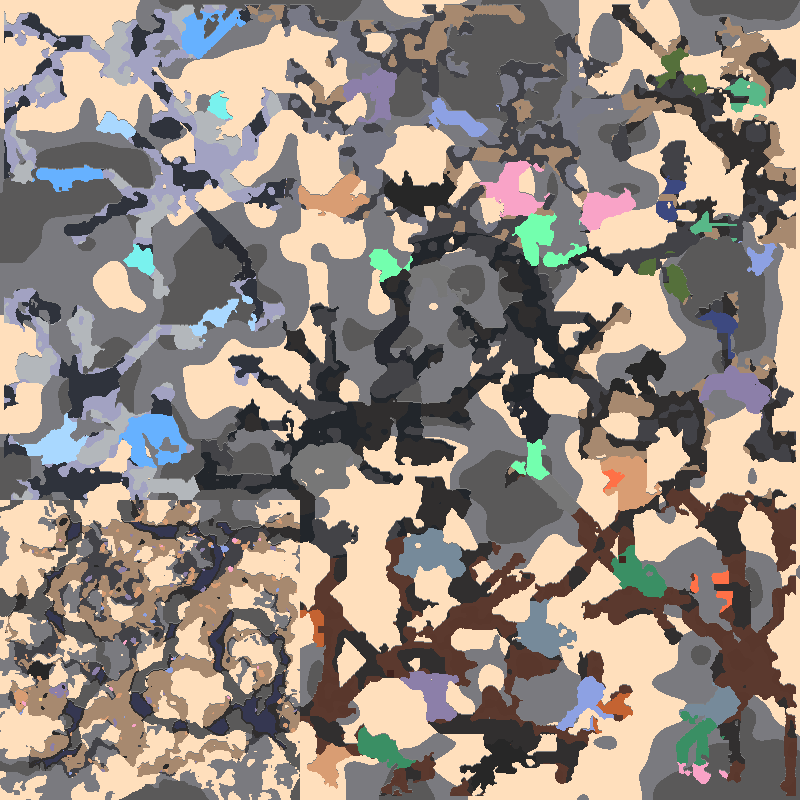

# Exogenesis: Aftershock

Expand your industry and defend an 800×800 labyrinth world against endless waves. A companion mod for **Mindustry 160.7 and Exogenesis 1.9.1**, available for PC and Android.

**[Download](https://github.com/Loewenkrieger/Exogenesis-Aftershock-Mod/releases/latest)** · [Deutsch](README.de.md) · [Production guide](docs/PRODUCTION.md)

## Install and play

1. Install Mindustry 160.7 and [Exogenesis 1.9.1](https://github.com/AureusStratus/ExoGenesis).
2. Download **Exogenesis-Aftershock.jar**, import it through **Mods → Import Mod**, and restart. Install only one Aftershock version at a time.
3. Choose **Play → Custom Game → Modded → Hasteland — Aftershock** and start Survival.

The map is included in the mod. Start with one Core Shard, 100 copper and wave 1; the first attack arrives after 120 seconds. Begin with mining, smelting and power, then develop Exogenesis chains and advanced Aftershock production. New blueprints are available immediately; materials and power determine your progress.

## What awaits you

- **Five biomes** with winding passages, natural building chambers and eight spawn zones.
- **24 industrial buildings**, from 2×2 logistics to 7×7 reactors and factories.
- Branching production with gases, heat, byproducts and **80% coolant recovery**. Inputs work on every side.
- **Nine turrets**, including three rapid-fire weapons, plus three friendly units.
- Endless mixed attacks and two phased endgame bosses. Multiple fronts open as waves progress; bosses appear every tenth wave.
- Individual pixel-art graphics and resource icons.

All 25 Exogenesis materials and six liquids are obtainable through deposits or production. See the [production guide](docs/PRODUCTION.md) for recipes and supplies.

## World settings

Open **Settings → Aftershock → World settings** to adjust the initial delay, wave and boss pauses, and difficulty. Defaults are **120 / 120 / 240 seconds**, difficulty **1.0**. Industry also works on other maps; Aftershock waves can be enabled there when a core and spawn zone are available.

Changes for each version are listed on the [Releases page](https://github.com/Loewenkrieger/Exogenesis-Aftershock-Mod/releases). Credits and license information: [NOTICE](NOTICE.md), [LICENSE](LICENSE).
